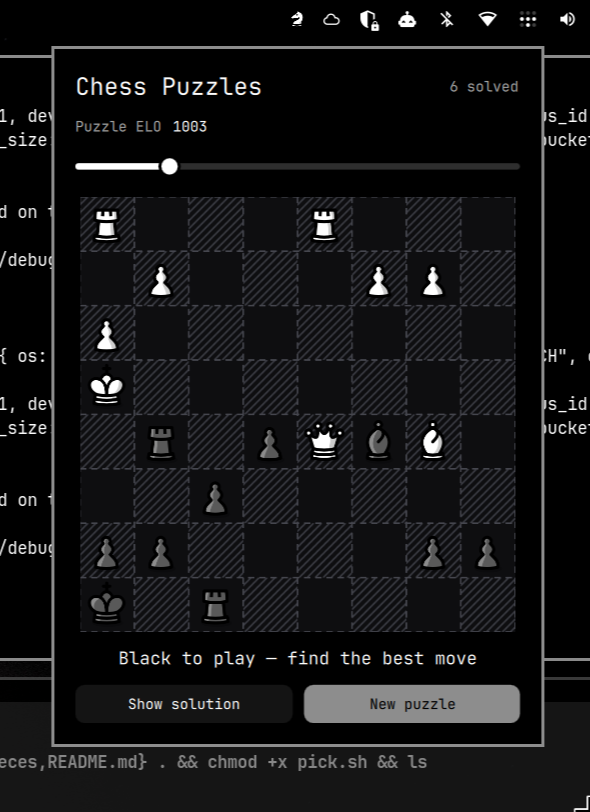

# chess-puzzles-qml

Chess puzzle trainer for the [Omarchy](https://omarchy.org/) status bar: a
Quickshell/QML shell plugin — white knight icon in the bar, popup panel with
a monochrome board, an ELO slider, and Lichess puzzles served from a local
cache.



The native Rust + Bevy twin of this plugin lives at
**[mtib/chess-puzzles-bevy](https://github.com/mtib/chess-puzzles-bevy)** —
same game logic, same puzzle data, standalone window app.

## Features

- **ELO slider** (600–2500, step 50): puzzles are served from a local cache,
  picking the one closest to your target rating while avoiding the ~80 most
  recently served.
- **Offline cache** seeded from the
  [Lichess puzzle database](https://database.lichess.org/) — popular puzzles
  bucketed across the whole rating range. The cache is required: Lichess's
  live puzzle API returns a PGN rather than a board position, so there is no
  online fallback.
- **Click-click input**, judged against the puzzle's solution list (no move
  generator — the solution is the only judge). Opponent replies auto-play;
  "Show solution" walks the line; wrong attempts flash the target square;
  promotions accepted on the first four characters.
- **Monochrome dark board** painted on a QML `Canvas`: pure black
  background, diagonal-hatched light squares, dashed cell outlines, orange
  moved/selected squares, fading move arrows, and monochrome user-drawn
  arrows (**shift+drag**), cleared by clicking an empty square.
- **Omarchy-native**: colors, fonts, and spacing come from the active shell
  theme; the popup is a real layer-shell surface anchored under the bar
  icon, with keyboard support (`n` new puzzle, `s` show solution, `f` flip).
- Board flips so the side to move sits at the bottom. A second bar widget
  can point at a different target ELO.

## Install

This is an Omarchy shell plugin (`~/.config/omarchy/plugins/`), so the
easiest install is via the Omarchy plugin tooling:

```sh
git clone https://github.com/mtib/chess-puzzles-qml \
  ~/.config/omarchy/plugins/mtib.chesspuzzles
omarchy plugin enable mtib.chesspuzzles
```

Then seed the puzzle cache once. **This is required**, the panel has no
puzzles until it has run:

```sh
python3 ~/.config/omarchy/plugins/mtib.chesspuzzles/seed.py
```

It streams the ~300 MB Lichess puzzle database, so it needs `curl` and
`zstd` and takes under a minute on a fast connection. It keeps about 30
puzzles per 100-ELO bucket (roughly 700 in total) and can be re-run to add
more.

### Troubleshooting

- **"Puzzle cache is empty: run python3 …/seed.py once"**: seed the cache as
  above.
- **Nothing happens after seeding**: `~/.config/omarchy/plugins/mtib.chesspuzzles/pick.sh 1500`
  should print one JSON puzzle. It needs `jq`.

State and cache live under `~/.local/state/omarchy/`
(`chesspuzzles/cache.jsonl`, `settings/chesspuzzles.json`).

## Layout

```
manifest.json    plugin declaration + settings schema
BarWidget.qml    the bar slot (white knight); loads Panel.qml
Panel.qml        the popup: slider, canvas board, status, buttons
Model.js         FEN parsing + UCI move application (castling, EP, promotion)
pick.sh          serve one puzzle near a target ELO from the cache
seed.py          one-off cache seeding from the Lichess puzzle database
pieces/          caliente piece art (SVG)
```

No legal-move engine: puzzle solutions come from Lichess's public puzzle
database (CC0).

## Credits

- Pieces: [caliente](https://github.com/avi-0/caliente) by avi-0 (unmodified).
- The native Rust + Bevy sibling:
  [mtib/chess-puzzles-bevy](https://github.com/mtib/chess-puzzles-bevy).

## License

MIT
